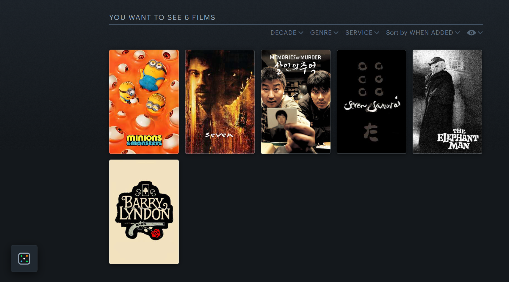
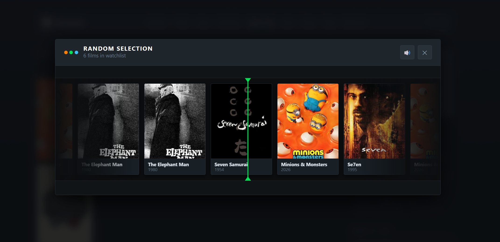
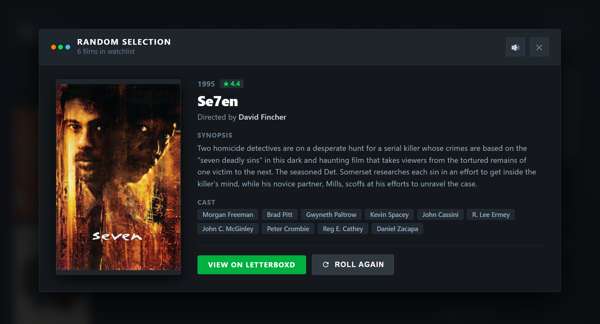
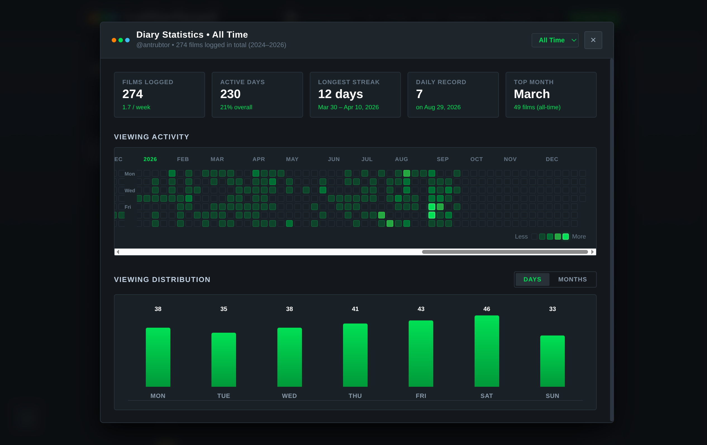
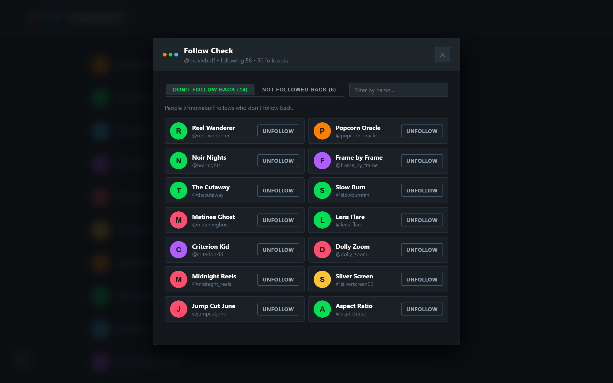

# 🎲 Letterboxd Companion (Watchlist Picker, Diary Stats & Follow Check)

A sleek, lightweight browser extension designed with **Letterboxd's authentic UI** that picks random movies from any watchlist with a smooth carousel animation, and visualizes your diary activity with GitHub-style heatmaps and comprehensive viewing statistics. On any Following / Followers page, it also shows who doesn't follow back (and who you don't follow back).

## ✨ Features

- **Random picker** on any watchlist **or list**. On a friend's watchlist, pick only among the films you **both** want to see; on a list, only among the ones already in your watchlist.
- **Diary statistics**: activity heatmap, streaks, average rating, rewatches, likes, reviews, distribution by day, month, rating and release decade, plus **On This Day** (what you watched on this date in previous years).
- **Follow check**: who doesn't follow back and who you don't follow back, with Follow / Unfollow buttons on your own lists.
- **Taste compatibility**: on another member's profile, a match score based on the films you both rated, the films you both loved, your biggest disagreements, and their favorites you haven't seen yet.
- **Settings** in the extension popup to switch each feature on or off.


---

## 📸 Screenshots

### 1. Watchlist Floating Button


### 2. Random Selection Reel


### 3. Movie Details Modal


### 4. Diary Activity Heatmap & Statistics


### 5. Follow Check (Following / Followers)

*Simulated data — all names are made up.*

---

## 🚀 Quick Install (Single-File)

Download the packaged extension from the **[Releases](https://github.com/Antrubtor/LetterboxRNG/releases)** page and install it in seconds:

### Chrome / Brave / Edge / Opera
1. Download `letterboxd-companion-vX.X.X.zip` from Releases.
2. Open `chrome://extensions/` and enable **Developer mode** (top-right toggle).
3. Drag & drop the downloaded `.zip` file directly into the page (or click **Load unpacked** / **Pack extension**).

### Firefox
1. Download `letterboxd-companion-vX.X.X-firefox.xpi` (or `.zip`) from Releases.
2. Open `about:debugging#/runtime/this-firefox`.
3. Click **Load Temporary Add-on...** and select the `.zip` or `.xpi` file directly without extracting.

### Safari (macOS)
1. Download and unzip `letterboxd-companion-vX.X.X.zip`.
2. In Safari > **Settings** > **Advanced**, check **"Show features for web developers"**.
3. In Safari > **Develop**, check **"Allow Unsigned Extensions"**.
4. In Terminal, run Apple's extension converter:
   ```bash
   xcrun safari-web-extension-converter /path/to/folder
   ```
5. Open the project in Xcode, click **Run** (`⌘R`), and enable the extension in Safari > **Settings** > **Extensions**.
