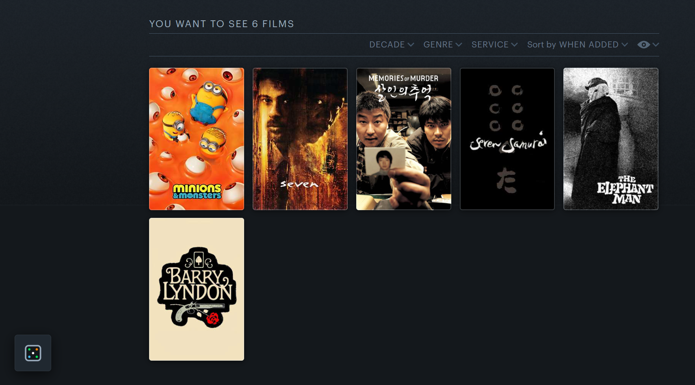
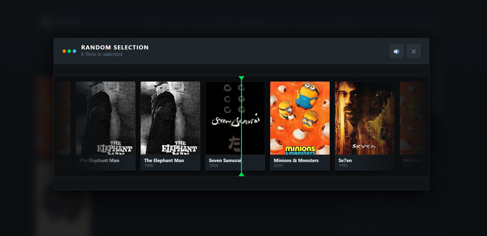
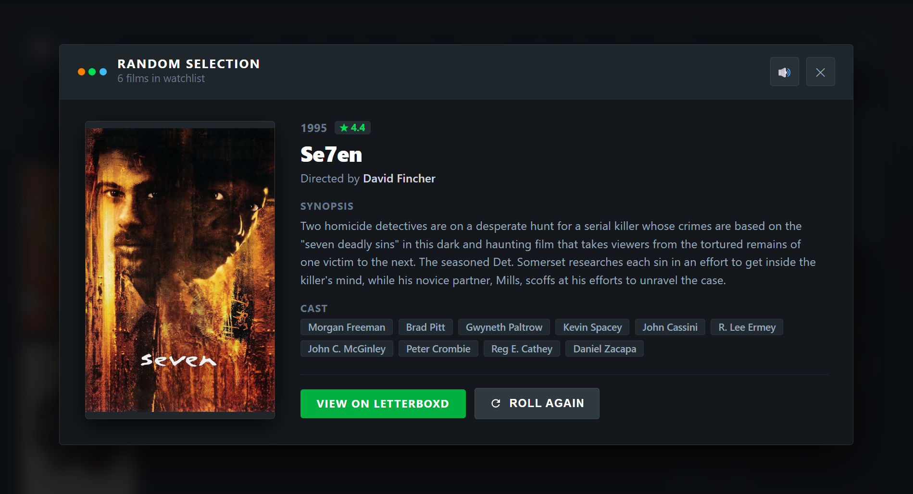
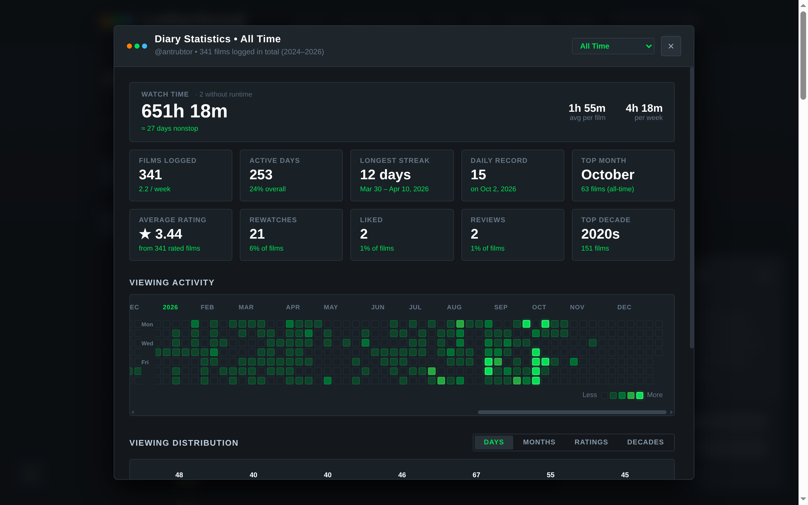
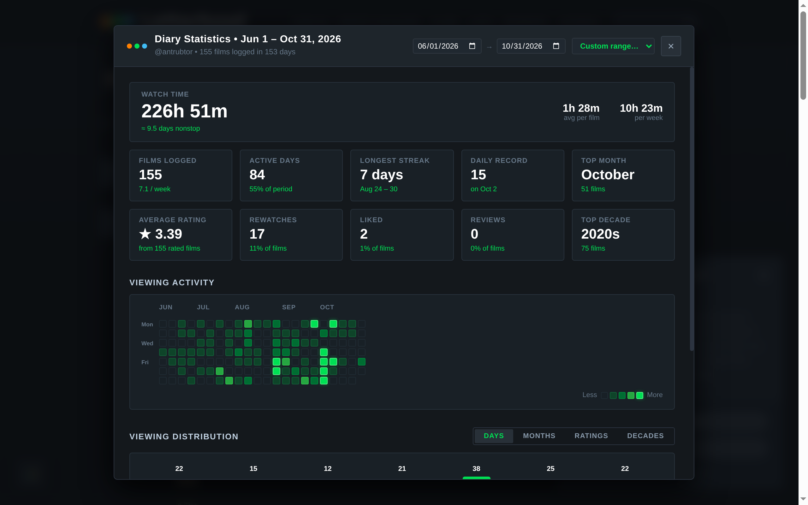
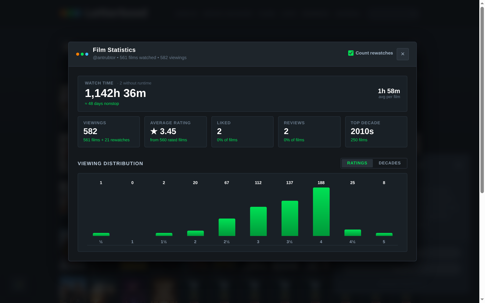
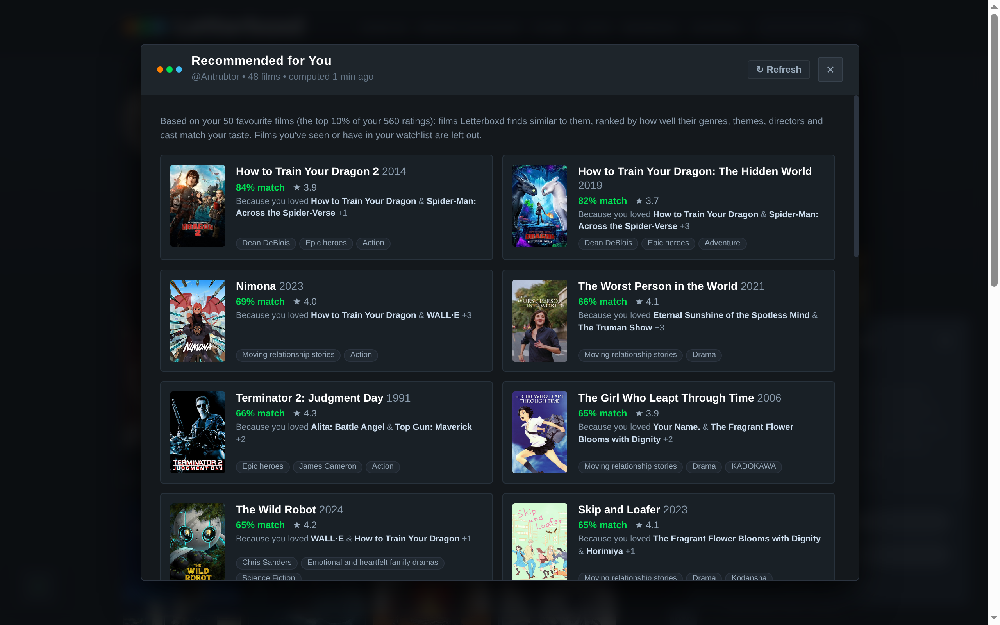
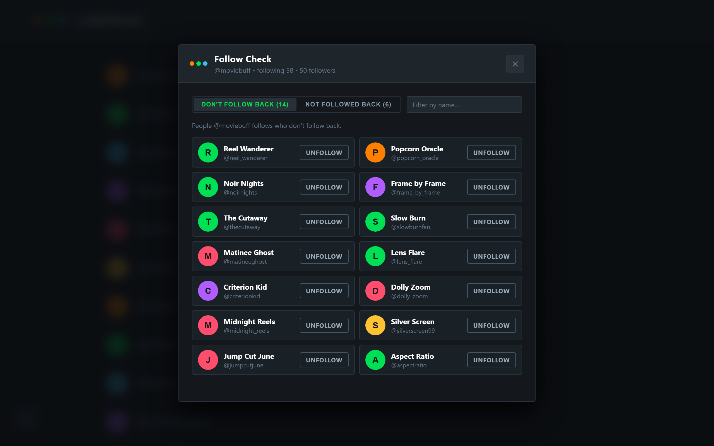
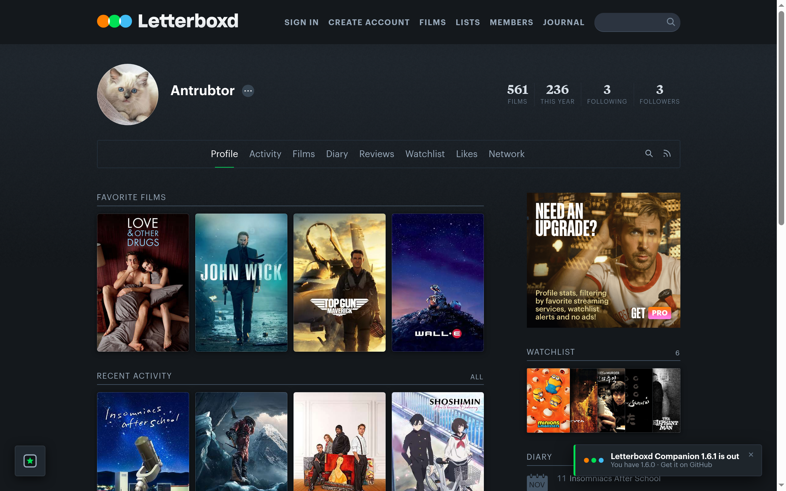
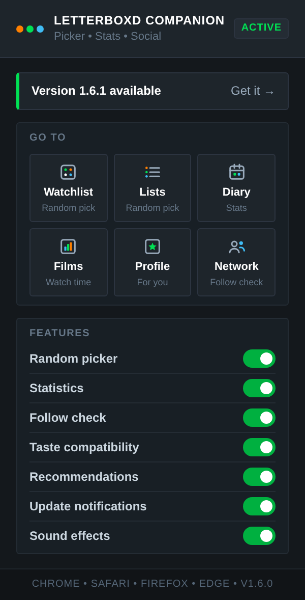

# 🎲 Letterboxd Companion (Watchlist Picker, Diary Stats & Follow Check)

A sleek, lightweight browser extension designed with **Letterboxd's authentic UI** that picks random movies from any watchlist with a smooth carousel animation, and visualizes your diary activity with GitHub-style heatmaps and comprehensive viewing statistics. On any Following / Followers page, it also shows who doesn't follow back (and who you don't follow back).

## ✨ Features

- **Random picker** on any watchlist **or list**. On a friend's watchlist, pick only among the films you **both** want to see; on a list, only among the ones already in your watchlist.
- **Diary statistics**: watch time (hours spent watching, from each film's runtime), activity heatmap, streaks, average rating, rewatches, likes, reviews, distribution by day, month, rating and release decade, plus **On This Day** (what you watched on this date in previous years). View all time, one year, or any custom date range.
- **Film statistics** on any member's Films page (and its filters, e.g. a genre or decade): watch time, average rating, likes, reviews, distribution by rating and release decade. Tick **Count rewatches** to count every viewing logged in the diary in the total and the watch time.
- **Follow check**: who doesn't follow back and who you don't follow back, with Follow / Unfollow buttons on your own lists.
- **Taste compatibility**: on another member's profile, a match score based on the films you both rated, the films you both loved, your biggest disagreements, and their favorites you haven't seen yet.
- **Recommendations** on your own profile: films picked from your favorites (the top 10% of your ratings). The extension builds a taste profile from their genres, themes, directors, cast, countries and studios, then ranks the films Letterboxd finds similar to them, leaving out everything you've watched or added to your watchlist. Each pick shows why ("Because you loved…") and the tags it shares with your taste.
- **Update notifications**: when a new release is out on GitHub, a notice links to it (closing it hides it for 24 hours). Firefox updates the extension by itself.
- **Popup**: shortcuts to every page with a feature (your watchlist, lists, diary, films, profile and network), and a switch for each feature.


---

## 📸 Screenshots

### 1. Watchlist Floating Button


### 2. Random Selection Reel


### 3. Movie Details Modal


### 4. Diary Statistics & Watch Time


### 5. Statistics Between Two Dates


### 6. Film Statistics (Films page, rewatches counted)


### 7. Recommendations (your profile)


### 8. Follow Check (Following / Followers)

*Simulated data — all names are made up.*

### 9. Update Notification


### 10. Popup: Shortcuts & Settings


---

## 🚀 Quick Install (Single-File)

Download the packaged extension from the **[Releases](https://github.com/Antrubtor/LetterboxCompanion/releases)** page and install it in seconds:

### Chrome / Brave / Edge / Opera
1. Download `letterboxd-companion-vX.X.X-chrome.xpi` from Releases and extract it (it's a zip archive: rename it to `.zip` if your system won't open it).
2. Open `chrome://extensions/` and enable **Developer mode** (top-right toggle).
3. Click **Load unpacked** and select the unzipped folder.
4. To update: replace the folder's files with the new release, then click the reload icon on the extension card. The extension tells you when a new release is out.

### Firefox
1. Download `letterboxd-companion-vX.X.X-firefox.xpi` from Releases (clicking it on GitHub only downloads it).
2. Open `about:addons`, click the gear icon › **Install Add-on From File…** and pick the downloaded file (or drag the file onto a Firefox window).
3. Confirm the install. The add-on is signed by Mozilla, so it stays installed after a restart, and Firefox installs new versions by itself.

Firefox 140 or later is required. To try an unreleased build, load the folder's `manifest.json` from `about:debugging#/runtime/this-firefox` › **Load Temporary Add-on…** (removed when Firefox restarts).

<details>
<summary>Maintainers: signing the Firefox build</summary>

Firefox only installs add-ons signed by Mozilla. The release workflow signs the `.xpi` as an unlisted (self-distributed) add-on and publishes the `updates.json` Firefox uses for automatic updates. It needs two repository secrets, from an [addons.mozilla.org API key](https://addons.mozilla.org/developers/addon/api/key/):

- `AMO_JWT_ISSUER`: the JWT issuer
- `AMO_JWT_SECRET`: the JWT secret

Without them the release still has the Chrome package, but no Firefox `.xpi`.
</details>

### Safari (macOS)
1. Download `letterboxd-companion-vX.X.X-chrome.xpi` and extract it (rename it to `.zip` first if needed).
2. In Safari > **Settings** > **Advanced**, check **"Show features for web developers"**.
3. In Safari > **Develop**, check **"Allow Unsigned Extensions"**.
4. In Terminal, run Apple's extension converter:
   ```bash
   xcrun safari-web-extension-converter /path/to/folder
   ```
5. Open the project in Xcode, click **Run** (`⌘R`), and enable the extension in Safari > **Settings** > **Extensions**.
